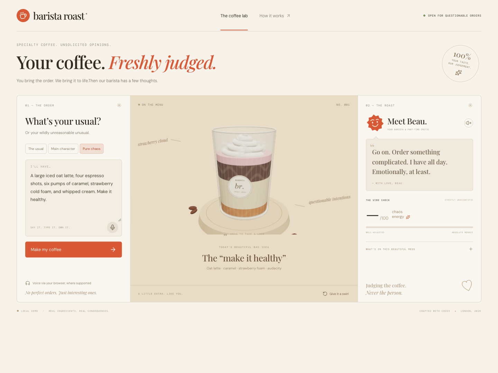

# Barista Roast

**Your coffee. Freshly judged.**

A tactile 3D coffee lab with a warm, opinionated barista. Order an outrageous drink, interrupt it mid-pour, and get a roast based on what actually ended up in the glass.

Built during the DevDay London hackathon on **1 November 2026** with Codex. The signature interaction: **you can change your mind, but you cannot un-pour caramel.**



[Watch the 55-second captioned demo](https://github.com/melnurx/barista-roast/raw/refs/heads/main/docs/demo.mp4) · [Public repository](https://github.com/melnurx/barista-roast)

## Run in two minutes

Requires Node.js **22.13+** (developed on Node 24) and npm.

```sh
npm ci
npm run dev
```

Open the Local URL printed by the server (usually http://localhost:5173). No API key, external assets, database, or account is needed for the complete local demo.

```sh
npm test           # deterministic state, parser, validation and fallback tests
npm run typecheck  # TypeScript
npm run build      # production Cloudflare Worker + browser assets
npm start          # serve the production build locally
```

The app uses the supplied OpenAI Sites/Vinext starter. Its helper scripts configure portable local execution; the deployment is a Cloudflare Worker, not a conventional Next.js Node server. `npm ci` uses the committed lockfile. Fonts are self-hosted. A WebGL-capable browser is recommended; a visible fallback keeps ordering and receipts usable if 3D fails.

## The 45-second experience

1. Choose **Pure chaos**, then **Make my coffee**.
2. Let the caramel begin pouring (after the ice).
3. Click **Actually…**, then **Make it healthy**.
4. Watch the future toppings disappear from the plan while the partial caramel amount stays locked in the ledger.
5. Get the final roast, drag the glass to inspect it, and download a PNG receipt.

Also try “No caramel and add two espresso shots” or “Switch to oat milk”. The planner accounts for partial amounts already poured. **Another round** deliberately starts a fresh glass.

## What works

- Original procedural glass, fluting, coffee beans, coaster, cream, floating ice, marbled liquid layers, pour stream, droplets and ripples.
- Text orders, three sample orders, natural-language changes, and a bounded ingredient catalog.
- Live immutable quantity ledger with pause/resume, future-plan reconciliation and capacity constraints.
- Friendly ingredient-grounded commentary and deterministic scores with visible arithmetic.
- Optional sound cues, orbit interaction, a swirl effect, final reveal and a downloadable receipt.
- Responsive desktop/mobile layout, keyboard controls, labelled input, modal focus handling and reduced CSS motion.
- Browser speech recognition when supported; failure leaves text fully usable.
- Optional server-side OpenAI interpretation, final roast and recorded-audio transcription, with timeouts and local fallback.

**Current demo is explicitly local mode.** Its parser and jokes are deterministic; they are not presented as live AI. The optional live OpenAI paths are implemented and tested with mocked responses, but have not been verified with a real key. Browser speech can depend on the browser vendor’s online service and microphone permission. Real-microphone recognition is not part of the automated verification.

## How it works

```text
Text / optional voice
        ↓
Local parser OR server-side OpenAI structured recipe
        ↓
Validate → preserve committed amounts → fit remaining capacity
        ↓
Deterministic pour plan → reducer ticks → actual quantities
        ↓                           ↓
Three.js visualization        transparent scoring
        ↓                           ↓
             grounded roast + receipt
```

The renderer never asks a language model to generate a frame. It derives the scene from actual ingredient state. Pours use geometric approximations, not full fluid physics. The swirl is a visual effect; it does not change the ingredient ledger.

Key files:

- `lib/contracts.ts`: ingredient catalog, units, capacities and shared types.
- `lib/recipe.ts`: parsing, validation, reconciliation, planning, scores and local humour.
- `lib/brew.ts`: reducer with monotonic committed quantities and partial-pour preservation.
- `components/CoffeeScene.tsx`: procedural Three.js scene via React Three Fiber.
- `components/CoffeeLab.tsx`: ordering, interruption, voice and receipt journey.
- `lib/server-ai.ts` and `app/api/*`: optional server-only API calls.

## Optional live OpenAI mode

Keep API keys server-side. Use Codex’s **OpenAI Developers** secure key setup when enabling live mode. The local Worker supports an ignored `.dev.vars` file; `.dev.vars.example` lists the variable names. Sites runtime secrets must be configured through its environment controls. Do not use a `NEXT_PUBLIC_` or `VITE_` key.

- `OPENAI_API_KEY`: optional. If absent, no OpenAI request is sent.
- `OPENAI_MODEL`: defaults to `gpt-6-luna`.
- `OPENAI_TRANSCRIBE_MODEL`: defaults to `gpt-transcribe`.

`POST /api/order` interprets one order using Responses structured JSON, then independently validates and reconciles it. `POST /api/roast` describes actual poured ingredients. Neither is called per animation frame. `POST /api/transcribe` accepts a bounded audio upload. `/api/health` returns configuration status, never a key. AI calls time out; the local core continues.

Official docs checked 1 November 2026: [Structured Outputs](https://developers.openai.com/api/docs/guides/structured-outputs), [GPT-6 Luna](https://developers.openai.com/api/docs/models/gpt-6-luna), [file transcription](https://developers.openai.com/api/docs/guides/speech-to-text), [pricing](https://developers.openai.com/api/docs/pricing). Standard Luna pricing was $0.10/M input and $0.50/M output tokens; `gpt-transcribe` was estimated at $0.0045/min. Account access and future pricing can differ. We deliberately skip the [Decisions API](https://developers.openai.com/api/docs/guides/decisions): our game scores should follow explicit arithmetic, and the remaining model work needs generative structured recipes/commentary.

## Transparent scores

Chaos is capped at 100: 9 per espresso shot beyond two + 5 per syrup pump + 12 per topping type + 20 for a “healthy” request with sweet extras + 6 per order change + 3 per ingredient beyond four. Only **poured** ingredients count during/following preparation. Complexity is 10 per ingredient + 8 per change, capped at 100. Sweetness is an internal game meter used to choose a fictional archetype.

These are playful scores, not nutrition facts or personality assessments. Ingredient quantities are simulation quantities, not an allergy or dietary certification.

## Codex use

See [CODEX.md](CODEX.md) for concrete engineering contributions and an example bug found and fixed during review. Codex researched the references, created the scene and state engine, wrote tests, reviewed the parser independently, exercised the real browser, and prepared the demo and deployment. We distinguish generated source code from live inference in the product.

## Submission material

- [Demo script and live pitch](docs/DEMO.md)
- [Concept decisions and research](docs/CONCEPT.md)
- [Verification evidence and limitations](docs/VERIFICATION.md)
- [Third-party attribution](THIRD_PARTY_NOTICES.md)
- [Deployment status and recovery](docs/DEPLOYMENT.md)

Original app code is MIT-licensed. Dependency and font licences remain their own. No SpiritAtlas code or assets were copied.
